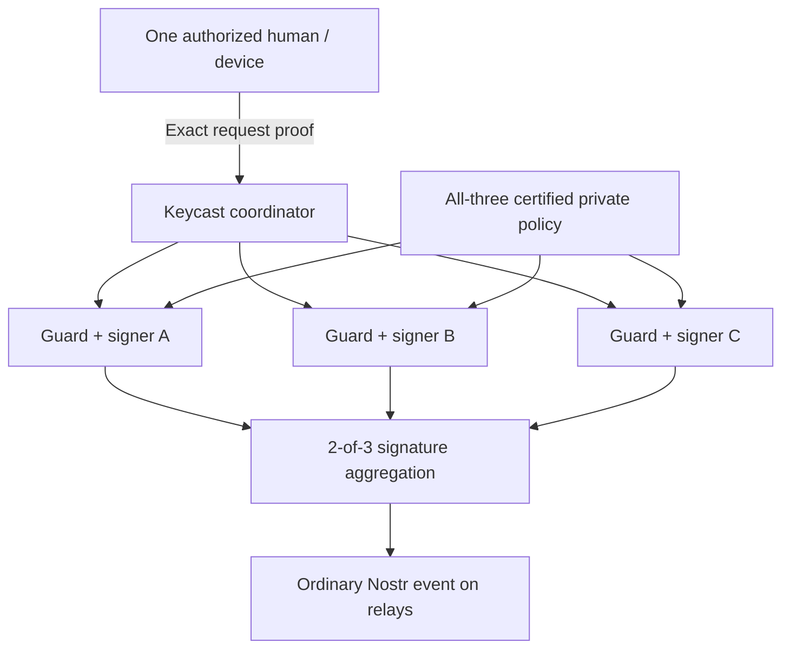

# Distributed custody for hosted Keycast identities

Status: proposed design for review, 2026-10-16. This document authorizes no
production rollout, migration, recovery-policy change or dependency installation.
The [research](../../research/2026-10-16-distributed-custody.md) records inspected
source commits and limits; the [plan](../plans/2026-10-16-distributed-custody.md)
defines a synthetic prototype and gates for any later implementation.

## Purpose and preserved product behavior

Reduce the consequence of compromising one Keycast instance. A current human
admin can still publish ordinary content while other admins are offline. An
infrastructure quorum is distinct from an optional human signing quorum. Clients
and relays receive ordinary NIP-01 events with standard BIP-340 signatures.

Recoverability remains the default objective, with no seed phrase, share handling
or additional backup password for ordinary users. Stronger custody requires a
recovery authority outside the public API; its exact user verification and
operator rules need approval before a production design is final. Independent
self-managed groups must retain zero Keycast dependency. Relay events remain the
public source of truth; admin identities never become NIP-51 list-member tags.

## Security claim and assumptions

Target: control of the public coordinator, its API database, its ordinary UCAN
issuer/transport credentials, and at most **one** signer domain must not produce
an event outside a current independently enrolled device's authority, add an
unauthorized admin/device, or release a threshold of signing material.

Assume the other two signer domains retain their pinned authority keys, durable
policy/fence state, local randomness and secret-share storage; the client device
and its authorization key remain trustworthy. This does not protect against a
threshold of signer compromises, a common deployment/cloud root controlling a
threshold, an authorized malicious admin, compromised user devices/mailboxes, or
malicious replacement client software. Browser code served by the compromised API
origin is not a trustworthy independent device; the client delivery boundary must
also be separated or the claimed guarantee narrowed.

This is distributed **custodial** signing, not noncustodial storage. Three Docker
processes, KMS keys or cloud projects under a single effective credential are not
three independent security domains. Availability against coordinator outage needs
separate ingress/transport failover; threshold signing alone does not provide it.

## Components and authority

- Coordinator: existing UCAN HTTP boundary, group discovery and request routing,
  standard NIP-46 adapter, aggregation and public result cache. Holds neither
  identity shares nor decryption authority over their recovery copies.
- Three signer domains: per-domain guard, one fixed participant share per
  identity, independent authenticated transport key, policy/fence journal and
  replay/session state. Each uses a distinct storage/KMS/service identity and
  deployment authorization. Each guard checks authority before cryptographic work.
- Device: independently held request key enrolled through a certified transition.
  A human's personal Nostr key held by Keycast is not an independent factor.
- Private policy: full tenant/group binding, identity pubkey, custody backend,
  fixed service roster/threshold, crypto and tweak versions, active human/device
  grants, permitted operations, grant epochs and recovery-rule digest. The API
  database projects this state; it cannot authoritatively rewrite it.
- Recovery: per-domain share restoration and independently verified new-device
  enrollment. Recovery never adds a participant or resumes nonce state.

The prototype uses local isolated processes and protected directories to test
protocol behavior. That is not evidence of real cloud/IAM separation. Production
acceptance requires a credential and deployment-authority access matrix showing
that no single compromised domain can administer a threshold.

## Signing authorization

The guard receives a complete event, the independently certified grant/policy,
exact session/selected signer identifiers and an authenticated client request.
It reconstructs the standard NIP-01 event ID and verifies all bindings. A device
request approved for one tenant, group, grant epoch or operation cannot authorize
another. Check before reserving commitments and again before releasing a partial.

Prototype native intent profile `keycast-custody-intent-v1` binds:

- protocol domain and operation `sign_event`;
- tenant ID, group ID and full group pubkey;
- policy digest/epoch, grant ID/epoch and device-key thumbprint;
- fixed keyset/roster/crypto/tweak version, exact two service participant IDs;
- UUID session ID, 32-byte random request ID, canonical Nostr event ID;
- issued/expiry times, with maximum lifetime 120 seconds and clock skew 30 seconds.

Use a versioned ordered JSON array for the domain-separated SHA-256 commitment;
encode IDs and versions as decimal strings, identifiers/pubkeys as complete hex,
and session IDs as canonical UUIDs. The device signs the digest with an enrolled
P-256 key; require fixed 64-byte signatures and reject unknown fields and versions.
This is a prototype wire profile, not a deployed mobile protocol. Cross-language
vectors and security review precede freezing it. UCAN continues to authenticate
HTTP; this proof authorizes the requested signing operation rather than adding a
parallel login scheme. Ordinary DPoP alone is not an event-body commitment.

Signer selection is infrastructure scheduling. The two selected services sign
without additional human prompts; retrying with another set requires a fresh
session/intent. A less interactive grant may permit any two members of a pinned
service pool, but is not part of this initial exact-set prototype.

For standard NIP-46 compatibility, investigate verifying and independently
decrypting the **original signed client request**, tied to a certified client
pubkey and independent bunker key. The NIP-46 event signs ciphertext, so forwarding
an API-decoded JSON body alongside that signature is not sufficient evidence.
The adapter must prove plaintext/request binding at each guard, replay protection (120-second request lifetime and 30-second clock skew)
and deterministic event construction before it is enabled. Standard clients do
not sign our native intent profile; do not claim the profiles interchangeable.
Both proof profiles produce an opaque guard-local authorization retaining its
evidence and scope, never a trusted serialized coordinator flag. Native evidence
requires the exact approved set/session. Legacy NIP-46 evidence requires a grant
explicitly permitting the pinned service pool; each guard binds the original
request digest to the actual internal session/set and rechecks it before partial
release. This does not claim the client signed those internal fields.
NIP-46 client requests omit the author pubkey legitimately: resolve it from the
certified grant before hashing, and reject any conflicting supplied author/ID.

## Policy agreement and revocation

Use **2-of-3 for cryptographic signing and all-three for policy transitions** in
the prototype. Two 2-of-3 policy certificates could intersect only at a malicious
node, so that threshold alone is not sufficient agreement for mutable authority.

A transition includes the exact parent digest/epoch, full next policy, unique
proposal ID, and a current authorized human/device proof. Each node validates the
action, persists a fence against signing under the parent, then signs one exact
child of that parent. It never votes for another child. All-three matching durable
votes form the transition certificate. A node installs the new policy only after
verifying that certificate. Return a completed mutation only after all-three
installation acknowledgments. New enrollment is unusable before certification. Initial bootstrap must also
independently establish the creator-to-device binding outside the public API;
an API UCAN alone cannot substitute an attacker device for an existing human.
The prototype pins that mapping through a trusted synthetic fixture; the real
onboarding authority is part of the production recovery/enrollment decision gate.

Prepared nodes pause signing for the identity. They do not discard the fence on
timeout or roll back their vote. Retrying resumes the same proposal; no automatic
cancellation, force-unlock or emergency single-node override exists. Recovery of
a stuck transition must preserve the vote/fence and resume it. If that cannot be
done, remain unavailable until a separately reviewed recovery/reconfiguration
procedure is approved. This deliberately favors safety over control-plane liveness.

After completed removal, neither old policy certificates nor cached sessions may
release a new partial. A partial or full signature released before the removal's
serialization point cannot be recalled. Tests exercise both sides of that point.
Already published events remain ordinary immutable public results.

Consequences to approve: one offline signer leaves ordinary 2-of-3 signing
available at an already committed policy, but blocks enrollment, removal and
recovery changes. A prepared transition can pause all signing. Do not promise
one-fault policy availability. If required, replace this prototype control plane
with an independently reviewed Byzantine agreement design; a three-node majority
or a fourth passive witness is not an automatic solution.

## Cryptography and FROSTR boundary

New identities use dealerless generation across the three signer domains, with
stable service participant IDs 1, 2 and 3, threshold 2, confidential authenticated
round-two delivery and complete signed round-one agreement. Never create all
shares on the public coordinator. Keep service participant IDs separate from
human-admin IDs and from the human-participant FROST API merged in PR #435.

Reference suite: `frost-secp256k1-tr = "=2.2.0"`, untweaked BIP-340/Nostr profile.
FROSTR Rust source is a pinned candidate, not a selected dependency. Demonstrate
round-trip package semantics, key parity/tweak handling, signing transcripts,
partial validation and final independent verification across the adapter. No
compatibility is inferred from the word FROST or a matching version number.
Reject threshold one, full-key reconstruction helpers and implicit server votes.

All inbound and outbound signing paths must pass the application guard. If the
candidate runtime cannot enforce it before consuming a nonce, do not expose that
runtime as an automatically responding peer. Select an approved interception
boundary/upstream change or use the official suite with a Keycast service protocol.
Do not modify cryptographic validation to make packages fit.

## Nonces, workers and rollback

Each service participant has one active installation incarnation. The incarnation
is certified independently of the coordinator and changes on replacement or
uncertain state recovery. Live nonce secrets are ephemeral and never serialized
or backed up. Pending sessions die with the process; retries may return a durably
cached computed partial/result but never recompute with a consumed nonce.

Workers atomically reserve each public commitment before use. Persist the spent
reservation and public partial before releasing that partial. Validate the exact
message, participant set and session; burn the session on uncertainty. A second
worker/clone cannot activate the same participant/incarnation concurrently.
Recovery rotates the incarnation, advances the certified policy epoch, invalidates
pending internal session packets and obtains a fresh certified policy high-water
mark from all domains before signing. Old native epoch approvals fail. A service-
only restart/recovery does not prove an old standard NIP-46 request was approved
after that recovery: under a still-current certified pool grant, an earlier signed
exact-event request can remain valid for its bounded 120-second lifetime (with
30-second clock skew). It may return a completed cached result or start an entirely
new internal session with fresh nonces, never resume the former session. Current
membership, grant and policy authorization are rechecked in either case. Timestamps
do not establish a client recovery-epoch commitment.

Human/device recovery is stricter: revoke the former device grant and rotate its
certified bunker transport recipient. Old-recipient requests cannot use the new
grant, whatever their timestamps. This is separate from restarting a service
participant and does not force every active client to re-enroll on service restart.
Restoring
an old database snapshot or a local file lock does not establish freshness.

The prototype must prove a recovery fence anchored outside the restored snapshot,
with an independently held epoch witness. If all authority/witness histories are
rolled back or unavailable, fail closed; do not claim rollback resistance. Review
FROSTR nonce-generation/state semantics against these requirements explicitly.

## Backup and replacement-device recovery

Each domain backs up only its participant package plus public binding metadata,
using its own wrapping key and storage/recovery access. The coordinator cannot
retrieve plaintext shares or authorize their release. A backup of all three
ciphertexts is acceptable only when one compromised credential still cannot
unwrap a threshold. Never co-locate the decryption authority merely because the
ciphertexts are encrypted. A restored copy remains the same participant.

Binding includes tenant/group/pubkey, service participant ID, keyset/roster and
crypto/tweak versions. Include independently recoverable policy/fence history and
KMS dependencies in the disaster-recovery procedure, but exclude live nonce
state, nonce seeds, pending handles and session/bunker tokens from share packages.

Lost human device: normal Keycast account recovery starts discovery, but cannot
by itself authorize a new device. A separately pinned recovery rule must validate
the new device key, current membership, case nonce and expiry outside the public
API, then obtain the all-three policy transition. Proposed user-friendly factors
are an existing synced passkey or independently operated verification of the
account's existing recovery channel. The latter must bind evidence to the exact
case/device and must not merely trust an API-minted assertion. Trust in a mailbox
or passkey provider is an explicit residual dependency.

This research does not choose recovery operators, factors, delay/veto rules or
who may override them. Those materially change recovery authority and require
product/security approval. The prototype uses synthetic independent recovery
approvals and a missing-proof denial; it does not claim production seedless
recovery is implemented. No mandatory second human group admin is introduced.

## Keycast integration and migration

Add a custody backend interface supporting public-key discovery and event signing;
retain current local-key behavior for existing identities. Persist an explicit
backend/crypto profile so failures never fall back to full-key custody. Implement
new hosted service custody as a distinct opt-in profile first. Personal account
migration and existing human-threshold groups are separate decisions.

Generate independent per-device bunker transport keys for the new profile. They
may be held by the coordinator/guards for request encryption but confer no group
signing or enrollment authority by themselves. Do not derive them from the full
identity key. Existing bunker URLs may need re-enrollment; preserve the identity
pubkey, not a promise that every historical transport credential survives.

An event-signing prototype is not complete NIP-46 parity. Before product rollout,
implement and verify threshold ECDH for required NIP-44/NIP-04 operations, or agree
and expose a deliberately limited capability profile. Raw canonical signing,
export, recovery, OAuth and first-party HTTP paths also require explicit coverage.
Never reconstruct an nsec to satisfy a missing method. No silent migration of
personal keys and no automatic export of unrelated identities.

For an existing identity, splitting its former full key preserves its pubkey but
cannot erase historical key copies. Migration must record that weaker provenance.
Prefer DKG for new identities. Share refresh/reconfiguration without reconstructing
the full key is not established by the examined FROSTR helpers; it needs separate
review. Recovered old shares and a mobile participant are never extra service votes.

## Acceptance and decisions before production

The plan tests actual cryptography, independent verification/relay round-trip,
coordinator-plus-one compromise containment, human/device/tenant binding, policy
forks/staleness, revocation races, crash and snapshot recovery, backup separation,
and one-admin usability. Simulated domains prove protocol tests only.

Production remains gated on: approved recovery authority and user flow; acceptance
of all-three policy availability limits or a replacement agreement protocol;
verified cloud/deployment separation; selected/pinned crypto/runtime with independent
review; mobile/standard-client proof contract; operation parity and migration
consent; measured performance and disaster recovery. No deployment, live-key
migration, production IAM/KMS change or new repository is authorized by this plan.
